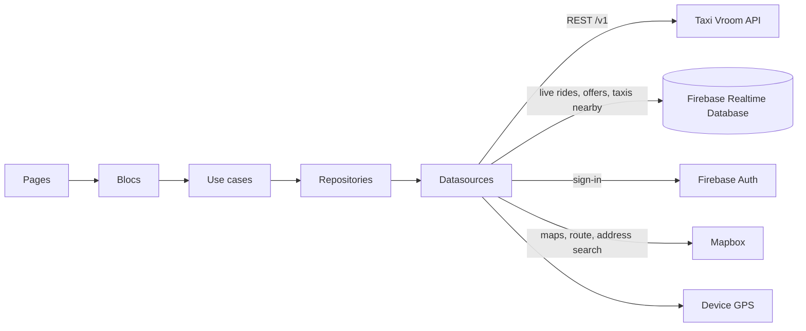

# Taxi Vroom Mobile

Flutter app of **Taxi Vroom**, a ride-hailing app for French licensed taxis. One app, two roles: a passenger gets a legal price estimate and orders a taxi, a driver goes online, accepts the offer and drives the ride with turn-by-turn guidance.

Backend (NestJS, PostgreSQL, Firebase): [taxi-vroom-api](https://github.com/TaxiVroom/taxi-vroom-api)

## Demo
https://github.com/user-attachments/assets/a5a6274a-ff3d-44c9-a1ac-9627ad9f8cf0

## Architecture



Every feature has the same layers: `presentation` (pages, blocs) → `domain` (entities, use cases) → `data` (repositories, datasources, models). The app is split by role:

```
lib/
├── app/             wiring: everything is built in app.dart and passed by constructor
├── core/            shared entities, network, location, theme, widgets, formatters
└── features/
    ├── authentication/
    ├── registration/    shared pages, passenger and driver flows
    ├── passenger_home/
    └── driver_home/
```

## Key decisions

| Decision | Why |
|---|---|
| Mapbox instead of Google Maps | Cost |
| Firebase Cloud Messaging for push | No messaging infrastructure to run |
| [`flow_builder`](lib/features/authentication/presentation/navigator/auth_navigator.dart) for every multi-step flow, instead of `go_router` | Screens are a function of the bloc state, so a flow cannot end up in an inconsistent state |
| [Bloc](lib/features/passenger_home/presentation/bloc/passenger_flow_bloc.dart) with sealed events, never Cubit | The UI only renders states. [`bloc_lint`](https://pub.dev/packages/bloc_lint) checks the practices. |
| Business logic in [domain use cases](lib/features/passenger_home/domain/usecases/watch_nearby_taxis_usecase.dart), not in blocs | Pure Dart, tested without Flutter, written test-first |
| [`Result<T>` and typed `Failure`](lib/core/utils/result.dart) in repositories | Blocs switch on a result. The technical exceptions stop at the repository. |
| Datasources return models, repositories return entities | The domain does not know the JSON |
| [One shared GPS stream](lib/core/data/datasources/shared_position_stream.dart) for the whole app | The Android plugin keeps the settings of the first stream, so the driver's background service never started. Found with `adb` and the plugin source. |
| [shadcn_flutter](https://pub.dev/packages/shadcn_flutter) instead of Material | One UI kit, with shared widgets in [`lib/core/widgets`](lib/core/widgets) |

Every feature starts with a spec, in the API repo ([`docs/specs/`](https://github.com/TaxiVroom/taxi-vroom-api/tree/main/docs/specs)): what the user sees step by step, then a sequence diagram.

## What it does

**Passenger**
- Search a destination, choose the pickup on the map, pick 1 to 8 passengers.
- A price range before ordering, computed by the API with the legal taxi meter formula.
- Follow the taxi live, give the boarding code, rate the ride.
- Book in advance, past rides, "Home" and "Work" shortcuts.

**Driver**
- Registration with documents, then validation.
- Go online, receive offers with a 15 s countdown, accept or decline.
- Turn-by-turn guidance, or open Google Maps or Waze already navigating.
- Boarding code, no-show, end of ride with the meter price, earnings by day, week and month.

## Run it locally

You need [Flutter](https://flutter.dev/) 3.38 or newer, the running [API](https://github.com/TaxiVroom/taxi-vroom-api), and your own Firebase project and Mapbox public token.

```sh
flutter pub get
# .env.dev at the repo root: API_BASE_URL, MAPBOX_ACCESS_TOKEN (public pk. token), FIREBASE_DATABASE_URL
dart run build_runner build --delete-conflicting-outputs
flutter run --flavor development --target lib/main_development.dart
```

Three flavors exist: `development`, `staging` and `production`, each with its own `lib/main_<flavor>.dart` and `.env.<dev|stg|prod>` file. After a change in an `.env` file, run `dart run build_runner clean` first, otherwise the old values stay in the generated code.

## Tests

```sh
very_good test --coverage
flutter analyze
dart run bloc_tools:bloc lint .
```

The tests cover the business rules: entities and use cases in pure Dart, written test-first, plus the network interceptor, the connectivity bloc and the shared GPS stream.

## What I'd improve

- Test on iPhone: the app targets Android and iOS, but only Android has been tested, for lack of an Apple device.
- Widget tests for the main screens.
- Recompute the driver's route when they leave it. Guidance computes it once today.
- Replace the placeholder Google sign-in button of the registration.

## How I work with AI

I set up a versioned [`.aimemory/`](./.aimemory) knowledge base in each repo that AI coding assistants must follow: the architecture, and working rules such as "write the spec first, no code without my approval". It lives in git, so the rules are reviewed like code. I make the design decisions and review every change.

## Contact

